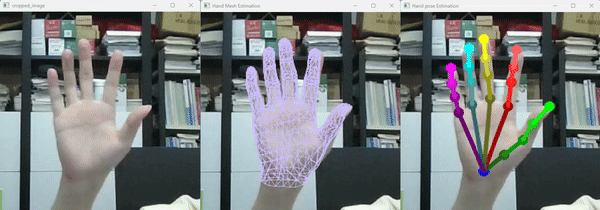
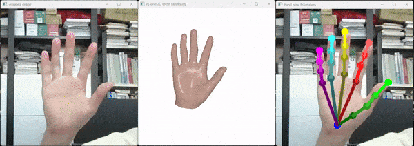
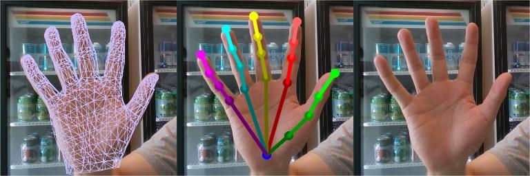
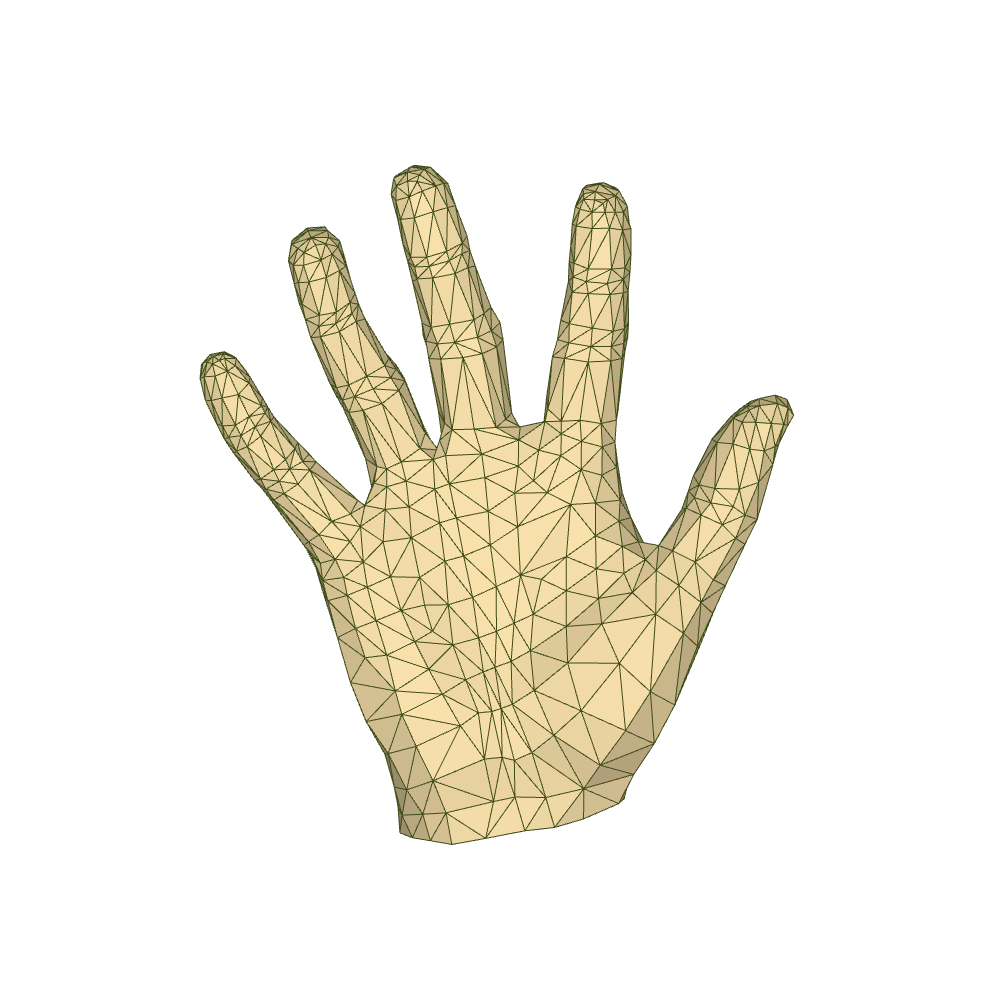
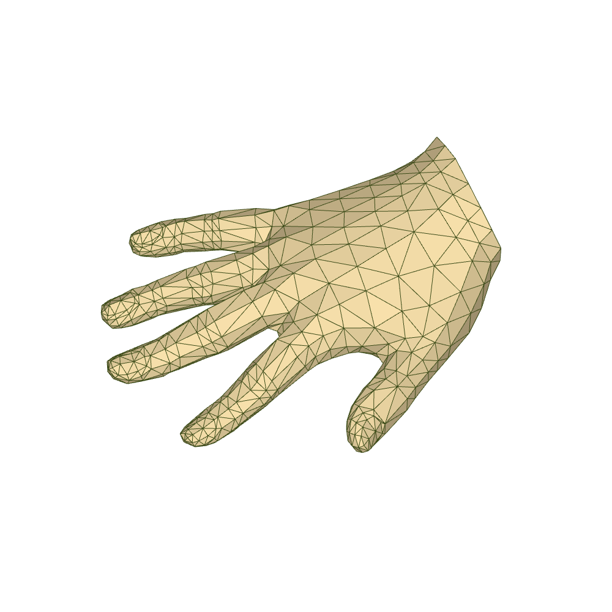
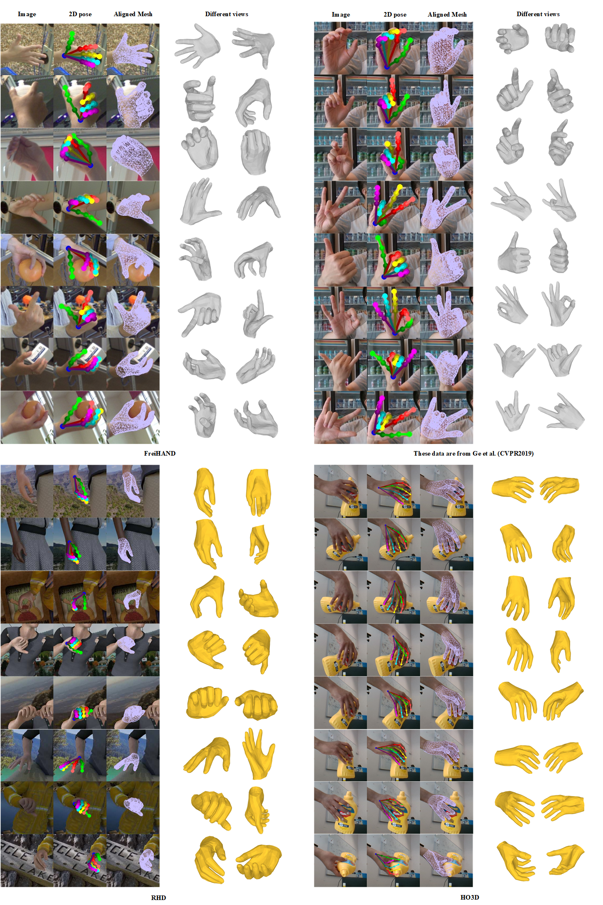
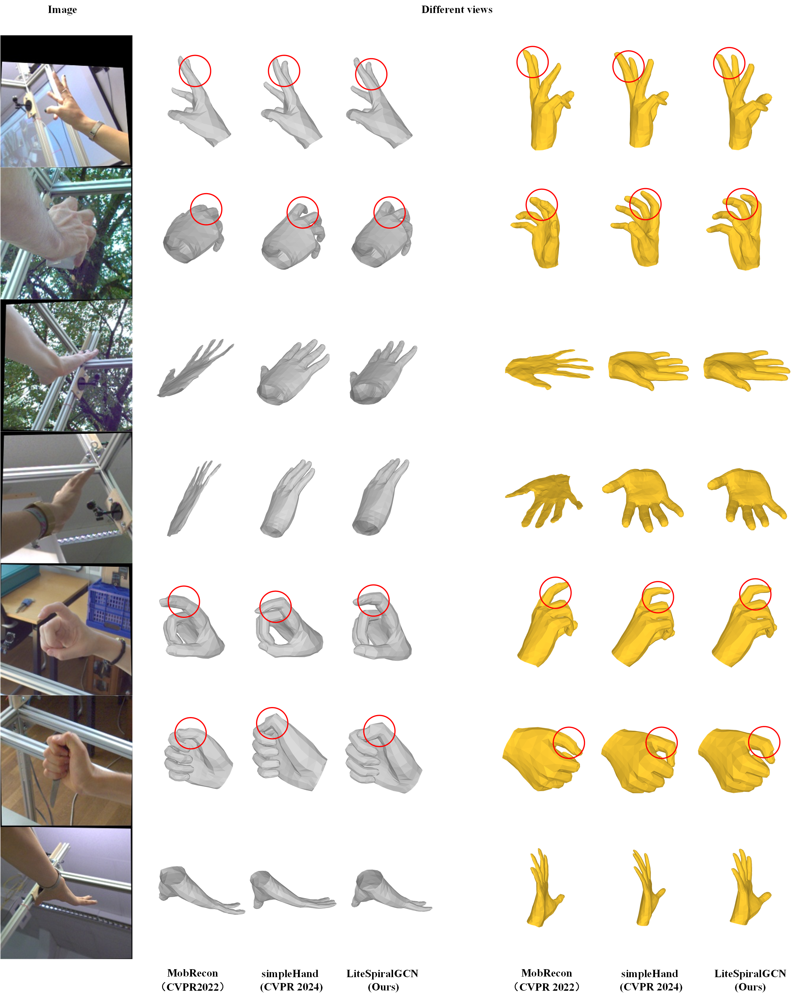

# LiteSpiralGCN: Lightweight 3D Hand Mesh Reconstruction via Spiral Graph Convolution


## Introduction
  This repo is the PyTorch implementation of hand mesh reconstruction described in **LiteSpiralGCN**.
  The code has been verified and successfully run for training and testing on **Windows 10**, **Windows 11**, **Ubuntu 18.04**, and **Ubuntu 20.04** systems.
  The model from the paper has already been used in competitions, and its dynamic performance can be viewed in this [Bilibili video](https://www.bilibili.com/video/BV1xj1FYwEuh).
## Update
+ 2025-2-24. Add more details on installation, training, and testing.
+ 2025-1-23. Add more Results.
+ 2024-5-20. Add LiteSpiralGCN model.

## Features
- [x] SpricalGCN
- [x] Attention Sampling
- [x] Weight-Shared Hand Mesh Refinement

## Install 
+ Environment
    ```
  conda create -n LiteSpiralGCN python=3.9
  conda activate LiteSpiralGCN
    ```
+ Please follow [official suggestions](https://pytorch.org/) to install pytorch and torchvision. We use pytorch=1.12.1-cuda11.3, torchvision=0.13.1
+ Requirements
    ```
  pip install -r requirements.txt
    ```
+ You need to install MPI-IS Mesh from this [link](https://github.com/MPI-IS/mesh) 
+ Direct installation of [PyTorch Geometric](https://pytorch-geometric.readthedocs.io/) may fail. We recommend first installing the following dependencies from this [link](https://data.pyg.org/whl/torch-1.12.1%2Bcu113.html):
```
  torch-cluster==1.6.0
  torch-scatter==2.0.9
  torch-sparse==0.6.15
  torch-spline-conv==1.2.1
```
+ You should accept [MANO LICENCE](https://mano.is.tue.mpg.de/license.html). Download the MANO model from [this link](https://mano.is.tue.mpg.de/download.php) and put `MANO_RIGHT.pkl` into [$ROOT/template](template).
+ Most of the modules in the code can be easily run individually to quickly check if the necessary libraries for the code are installed. The quick test code for each module is as follows:
  ```
  python LSG/models/AGCN.py
  ```
  ```
  python LSG/models/MHSA.py
  ```
  ```
  python LSG/models/densestack.py
  ```
  ```
  python LSG/models/litespiralgcn.py
  ```
## Real-time demo
+ Download the pre-trained weights of LiteSpiralGCN from [Baidu cloud](https://pan.baidu.com/s/1n5OtppDWe6UQX7bhBAbvww) and fill in the correct weight address in line 8 of the [$ROOT/LSG/LiteSpiralGCN.yml](LSG/configs/LiteSpiralGCN.yml).
+ To visualize the 778 vertices of the generated hand mesh using the `OpenCV` library, and visualize the 21 2D hand keypoints generated in the intermediate stages of the model, please run:
  ```
  python ./LSG/main.py --PHASE demo --config_file .\LSG\configs\LiteSpiralGCN.yml
  ```
  The real-time results during execution are shown in the animated image below.  

  
+ We also utilize the `PyTorch3D` library for more detailed rendering to approximate a more realistic 3D hand. Please run:
  ```
  python ./LSG/main.py --PHASE demo_pt3D --config_file .\LSG\configs\LiteSpiralGCN.yml
  ```
  The real-time results during execution are shown in the animated image below.

  
## Mesh file generation
+ We simultaneously generate rendered images of the hand mesh and 2D hand pose, along with files in `PLY` file (e.g., 000_mesh.ply) for the hand mesh. Please run:
  ```
  python ./LSG/main.py --PHASE demo_test_new_data --config_file .\LSG\configs\LiteSpiralGCN.yml
  ```
  NOTE: To ensure the paths are correct, please modify lines `423`, `426`, and `454` in the [$ROOT/LSG/runner.py](LSG/runner.py). The corresponding generated files for each line are as follows:
  ```
  Line 423: The concatenated image composed of the input image, the predicted 2D pose mapped onto the input image, and the predicted 3D mesh mapped onto the input image.
  Line 426: The image that needs to be predicted.
  Line 454: The generated hand mesh file in PLY format.
  ```
  The figure below shows the input image, 2D pose, and 3D mesh.

  <p float="left">
  
  </p>
  
  The following are visualization images of the hand mesh in `PLY` format from different perspectives.
  <p float="left">
    
    
  </p>
+ To facilitate quick visualization of the hand meshes reconstructed by our model, we have placed the prediction results with filenames `result_461.png`, `result_2491.png`, `result_3629.png`, `result_7077.png`, `result_16316.png`, `result_34814.png`, and `result_36198.png` in [$ROOT/docx](docx). Corresponding `PLY`-format hand mesh files are also provided with the filenames `461_mesh.ply`, `2491_mesh.ply`, `3629_mesh.ply`, `7077_mesh.ply`, `16316_mesh.ply`, `34814_mesh.ply`, and `36198_mesh.ply`. These `PLY`-format hand mesh files can be easily viewed from different angles using an [online OBJ viewer](https://3dviewer.net).
## Dataset preparation
#### FreiHAND
+ Please download FreiHAND dataset from [this link](https://lmb.informatik.uni-freiburg.de/projects/freihand/), and extract it to the `data/FreiHAND` directory.
+ Download mesh GT file `freihand_train_mesh.zip` from [Baidu cloud](https://pan.baidu.com/s/1n5OtppDWe6UQX7bhBAbvww), and unzip it under `data/FreiHAND/training` directory.
#### Real World Testset
+ Please download the dataset from [this link](https://github.com/3d-hand-shape/hand-graph-cnn/tree/master/data/real_world_testset), and extract it to the `data/Ge` directory.
#### Complement data
+ You can download files from [here](https://drive.google.com/drive/folders/1V3Ioy3H1vGPG4mURsCon9TE7j5eGFanN), and unzip it under `data/Compdate`.

#### Data dir
```  
  ${ROOT}  
  |-- data  
  |   |-- FreiHAND
  |   |   |-- training
  |   |   |   |-- rgb
  |   |   |   |-- mask
  |   |   |   |-- mesh
  |   |   |-- evaluation
  |   |   |   |-- rgb
  |   |   |-- evaluation_K.json
  |   |   |-- evaluation_scals.json
  |   |   |-- training_K.json
  |   |   |-- training_mano.json
  |   |   |-- training_xyz.json
  |   |-- Ge
  |   |   |-- images
  |   |   |-- params.mat
  |   |   |-- pose_gt.mat
  |   |-- Compdata
  |   |   |-- base_pose
  |   |   |-- trans_pose_batch1
  |   |   |-- trans_pose_batch2
  |   |   |-- trans_pose_batch3
```
  Please fill in the correct dataset paths on line `13` and `16` of [$ROOT/LSG/configs/LiteSpiralGCN.yml](LSG/configs/LiteSpiralGCN.yml) and line `41` of [$ROOT/LSG/configs/defaults.py](LSG/configs/defaults.py).
  The dataset corresponding to each line's path is as follows:
```
  Line 13 of LiteSpiralGCN.yml: FreiHAND dataset.
  Line 19 of LiteSpiralGCN.yml: Compdata dataset.
        Line 41 of defaults.py: Ge dataset.
```
## Training

+ If you wish to use the test set of FreiHAND directly to guide training, please download the FreiHAND test set labels from [this link](https://lmb.informatik.uni-freiburg.de/data/freihand/FreiHAND_pub_v2_eval.zip). After downloading, the file structure should be as follows:

```
  out  
  |-- MultipleDatasets 
  |   |-- LiteSpiralGCN
  |   |   |-- ref
  |   |   |   |-- evaluation_errors.json
  |   |   |   |-- evaluation_K.json
  |   |   |   |-- evaluation_mano.json
  |   |   |   |-- evaluation_scale.json
  |   |   |   |-- evaluation_verts.json
  |   |   |   |-- evaluation_xyz.json
  |   |   |-- checkpoints 
  |   |   |   |-- mobrecon_GCN_checkpoint_076.pt
  |   |   |-- log.log
  |   |   |-- board
  |   |   |-- test

```  
+ Download the pre-trained weights of densestack from [Baidu cloud](https://pan.baidu.com/s/1n5OtppDWe6UQX7bhBAbvww) and fill in the correct weight address in line `234` of [$ROOT/LSG/models/densestack.py](LSG/models/densestack.py).
+ Please fill in appropriate training parameters in [$ROOT\LSG\configs\LiteSpiralGCN.yml](LSG/configs/LiteSpiralGCN.yml). Run:
```
  python ./LSG/main.py --exp_name LiteSpiralGCN --PHASE train --Local_testing --config_file .\LSG\configs\LiteSpiralGCN.yml
```
## Evaluation
#### FreiHAND
+ Please run the following code to generate the 3D hand mesh vertex file.
```
  python ./LSG/main.py --exp_name LiteSpiralGCN --PHASE pred --config_file .\LSG\configs\LiteSpiralGCN.yml
```
  The generated `JSON` file containing the hand mesh vertices is saved by default to [$ROOT/LSG/out/MultipleDatasets/LiteSpiralGCN/](LSG/out/MultipleDatasets/LiteSpiralGCN). You can also modify line `358` of [$ROOT/LSG/runner.py](LSG/runner.py) to customize the save address of the `JSON` file according to your needs. You can submmit this file to the [official server](https://competitions.codalab.org/competitions/21238) for evaluation.

+ If you want to use the local FreiHAND test set labels for testing, please run:

```
  python ./LSG/main.py --exp_name LiteSpiralGCN --PHASE pred  --Local_testing --config_file .\LSG\configs\LiteSpiralGCN.yml
```
  NOTE: Please fill in the correct addresses at lines `362`, `363`, `364`, and `365` in [$ROOT/LSG/runner.py](LSG/runner.py) according to the comments next to the code. The representation of each line of the address is as follows:
```
  Line 362: The directory where the JSON files of the mesh vertices for the FreiHAND test set generated by this model are located. Typically, it is located at  $ROOT/LSG/out/MultipleDatasets/LiteSpiralGCN/ .
  Line 363: The output address for the results in txt text format.
  Line 364: The name of the JSON file containing the predicted hand mesh vertices by the model.
  Line 365: The address of the validation script. By default, it is $ROOT/LSG/freihand-master/eval.py .
```
  Here is an example output
```
  Evaluation 3D KP results:
  auc=0.00003, mean_kp3d_avg=11.80907 cm
  Evaluation 3D KP ALIGNED results:
  auc=0.87098, mean_kp3d_avg=0.64989 cm

  Evaluation 3D MESH results:
  auc=0.00003, mean_kp3d_avg=11.82267 cm
  Evaluation 3D MESH ALIGNED results:
  auc=0.86832, mean_kp3d_avg=0.66195 cm

  F-scores
  F@5.0mm = 0.00736 	F_aligned@5.0mm = 0.73736
  F@15.0mm = 0.03561 	F_aligned@15.0mm = 0.98032
```

#### Real World Dateset

```
  python ./LSG/main.py --exp_name LiteSpiralGCN --PHASE eval --config_file .\LSG\configs\LiteSpiralGCN.yml
```
  NOTE: The model has not been trained on `the Real World Dataset`.
## Results
  The table below shows the performance of our LiteSpiralGCN on the FreiHAND dataset, along with the cases without the AS module or without the SpiralGCN module.

|  Model    | PA-MPJPE | PA-MPVPE |
|  :----:  |:--------:|:--------:|
| Ours (Only AS )   |   6.7    |   6.9    |
| Ours (Only SpiralGCN )  |   6.5    |   6.7    |
| Ours (Both AS and SpiralGCN)  |   6.5    |   6.6    |


<p float="left">
  
</p>
<p float="left">
  
</p>

## Acknowledgement
  Our experiment is built upon an open-source GitHub repository. We would like to express our gratitude to the authors of the following listed code, whose work has greatly facilitated the progress of our experiment. If their work has been helpful to you, please consider citing them.
+ [HandMesh](https://github.com/SeanChenxy/HandMesh)
+ [SAR](https://github.com/zxz267/SAR)
+ [freihand](https://github.com/lmb-freiburg/freihand)
